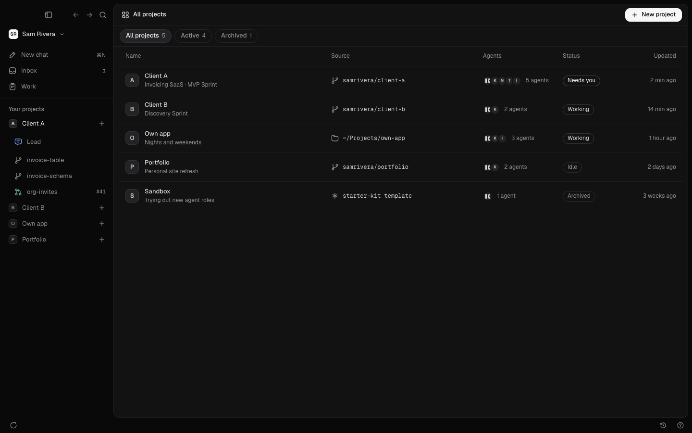
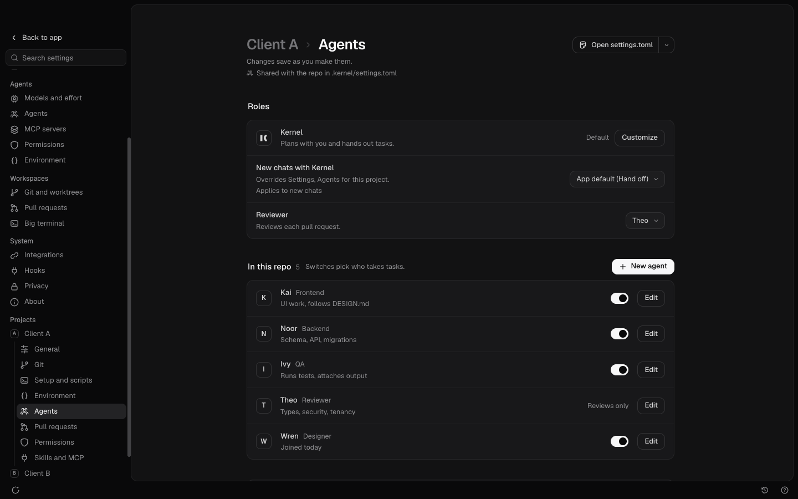
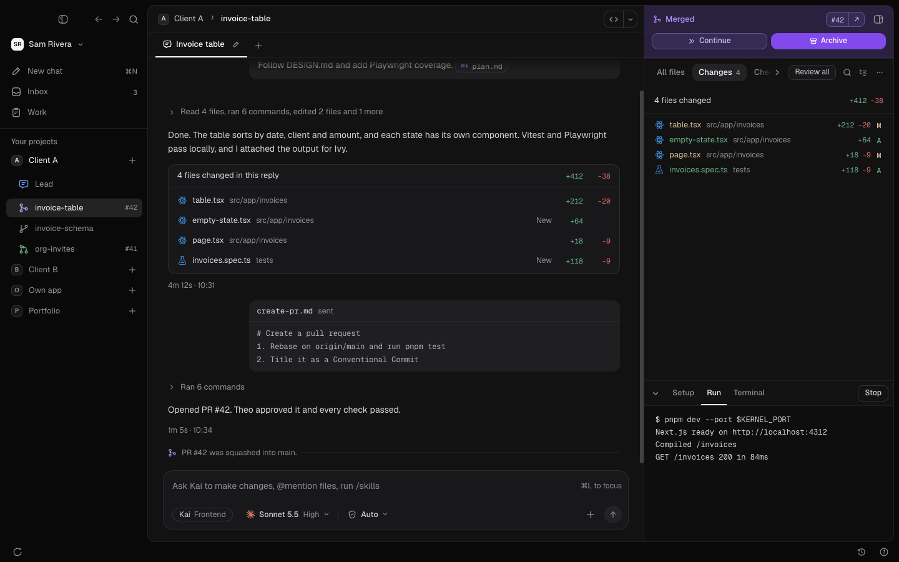
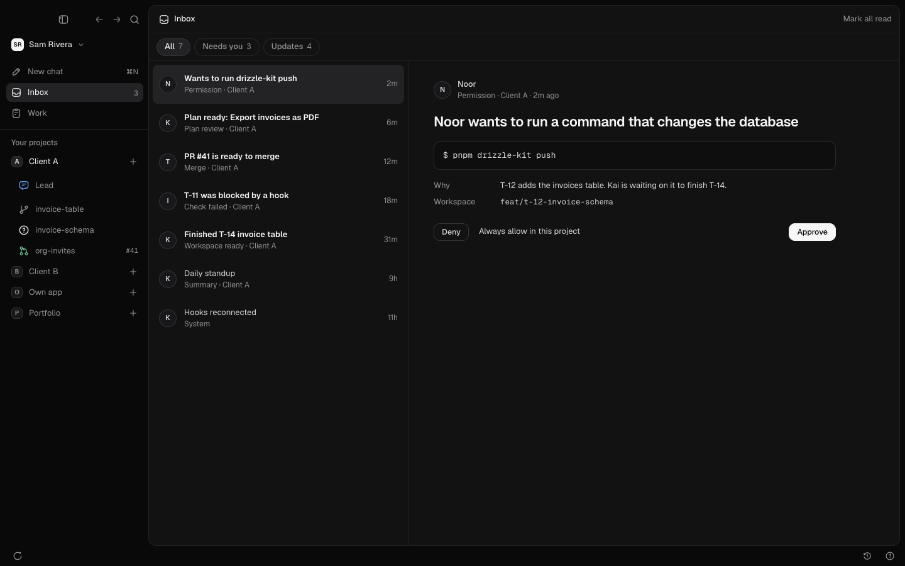
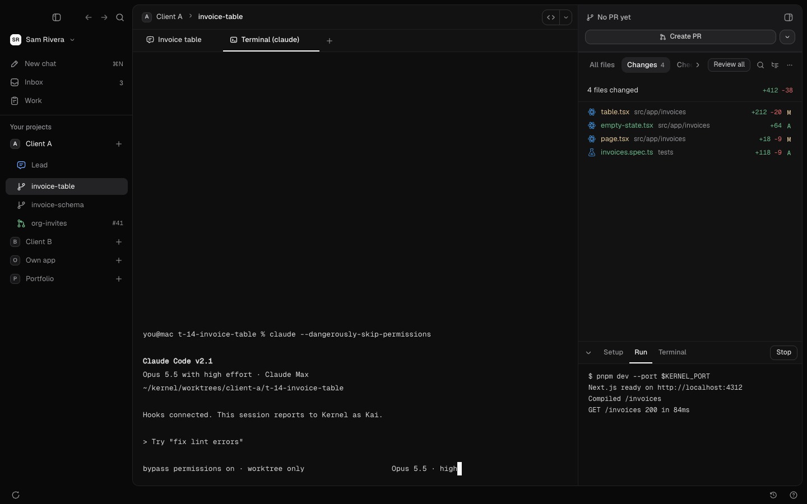

# Kernel

Your coding agents, working as a team. Brief a lead, approve the plan, and merge what the team builds. Kernel runs Claude Code and Codex agents on your Mac, each in its own git worktree. They ask before anything risky, open pull requests and wait for you to merge.

**[Download Kernel for Mac (Apple silicon)](https://github.com/cjjutba/kernel/releases/latest/download/Kernel-arm64.dmg)** · [Website](https://kernel.cjjutba.dev)



## Requirements

- A Mac with Apple silicon, on a recent version of macOS
- A Claude plan for [Claude Code](https://docs.claude.com/en/docs/claude-code), a ChatGPT plan for [Codex](https://developers.openai.com/codex), or both. Either one is enough. Kernel brings its own copy of each.
- git
- The [GitHub CLI](https://cli.github.com) (`gh`), signed in, for pull requests

On first launch Kernel checks Claude Code, Codex if a role runs on it, your sign-ins and the GitHub CLI, and tells you how to fix whatever is missing.

## How it works

### Projects and the team

Each repo you add is a project, and every agent in the repo's `.claude/agents/` folder is on its team, along with your personal agents. Settings, Agents lists them and sets which ones take tasks. The sidebar lists each project's Lead chat and its workspaces, and the Inbox shows what needs you across all of them. Every status comes from real Claude Code and Codex events. Nothing changes on a timer, so an idle agent looks idle.



### Kernel plans and hands off

Kernel is the Lead. Open the project's Lead chat from the sidebar and brief Kernel in a sentence or two. The Lead runs on Claude Code or Codex, whichever you set in Settings, Models and effort. Kernel works out a plan in plan mode and brings it to you. You approve it or ask for changes. Once you approve, Kernel creates one workspace per task and hands each one to the right teammate. Each teammate runs on Claude Code or Codex, as set for its role.


### Workspaces and pull requests

A workspace is one task: a git worktree on its own branch, with its own port for the dev server. You can chat with the agent, read the diff file by file, run setup and run scripts, and open a pull request when it's ready. Checks show up in the workspace. After the merge, archive the workspace and it moves to History.



### The Inbox

Anything that needs a decision lands in the Inbox: a command an agent wants to run, a plan to review, a question, a PR that's ready to merge. You can approve a command once or always allow it in that project. Nothing merges by itself.



### Checkpoints and the big terminal

Kernel snapshots the worktree after every agent turn. If a turn goes wrong, use Revert files to here in the menu under an earlier reply and the files go back while the chat stays. When you want the plain CLI, open a terminal tab in the workspace. It runs `claude` or `codex` in the same worktree, and Kernel still follows the session.




## Privacy

Kernel runs on your own Claude or ChatGPT plan, using the sign-in you already have. There is no Kernel account and no Kernel server. Your projects, chats, settings and history stay in a local database on your Mac.

Kernel itself makes these network calls and no others:

- Claude Code and Codex, which talk to Anthropic and OpenAI as they always do
- Anthropic or OpenAI, once, to check an API key when you add one in Settings, Providers
- `gh`, for pull requests and checks
- git, to fetch and push branches on your repo's own remote, and your package manager when a new project installs dependencies
- The update check, which reads this repo's GitHub Releases
- An offline check, a DNS lookup of `api.anthropic.com`
- Linear, only if you connect it in Settings
- Usage data, only if you turn it on in Settings, Privacy. Kernel asks once. It sends anonymous counts of what goes wrong and the class of an error, never code, prompts, file paths or names, and Settings, Privacy lists every event it kept or sent

## Build from source

You need Node 22 or later and the Xcode command line tools.

```sh
git clone https://github.com/cjjutba/kernel.git
cd kernel
pnpm install
pnpm dev
```

`pnpm install` also rebuilds the native modules for Electron. `pnpm dist:mac` builds an unsigned app into `dist/`. See [CONTRIBUTING.md](CONTRIBUTING.md) for tests and pull requests, and [docs/RELEASING.md](docs/RELEASING.md) for signed releases.

## How Kernel was built

Claude Code agents built Kernel one Linear issue at a time, working from a canvas of screen designs. [docs/DECISIONS.md](docs/DECISIONS.md) and [docs/decisions/](docs/decisions/) record every choice someone might later want to undo, with the reason. They are kept as they were written.

## License

Kernel's source is available under the [Elastic License 2.0](LICENSE.md). In plain terms:

- You can use Kernel for free, fork it, modify it and self-host it, for personal or commercial work.
- You can't sell Kernel to others as a hosted or managed service.
- You can't remove or work around license keys, if Kernel ever has them.

This summary isn't the license. [LICENSE.md](LICENSE.md) is.

Contributors sign the [contributor agreement](CLA.md) before their first pull request merges.
